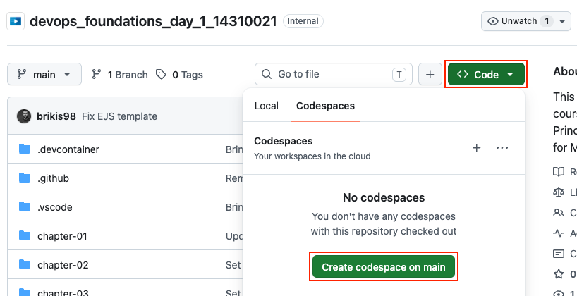
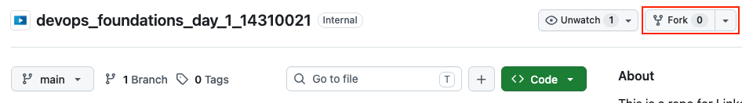

# DevOps Foundations Day 1

This is the repository for the LinkedIn Learning course `DevOps Foundations Day 1`. The full course is available from
[LinkedIn Learning][lil-course-url].

![course-name-alt-text][lil-thumbnail-url] 

# Course description

In this hands-on course, instructor Yevgeniy Brikman introduces DevOps as an end-to-end system for modern software delivery, using a realistic BusinessCorp/Vervium CloudAI scenario to connect concepts to practical decisions and workflows. Learners explore deployment options, infrastructure as code, microservices, Kubernetes, CI, CD, GitOps, observability, SRE, data durability, networking, and security practices. Along the way, they practice choosing the right deployment and orchestration approaches, creating safer pipelines, troubleshooting outages, protecting data and secrets, and applying safety principles to improve delivery without increasing risk.

# Learning objectives
- Explain the core principles and practices that underpin successful DevOps organizations.
- Choose the right deployment, infrastructure, and orchestration approaches for modern cloud applications.
- Build and manage infrastructure using Infrastructure as Code and automation tools.
- Create CI/CD and GitOps workflows that enable safer and more frequent software releases.
- Use observability and incident response practices to identify, diagnose, and resolve production issues.
- Apply reliability, networking, data durability, and security principles to build resilient production systems.
- Evaluate emerging DevOps considerations, including GenAI productivity, safety, and risk management.

## Getting started

For all labs in this course, you can choose from one of the two following options:

1. **Codespaces**. Codespaces gives you a virtual environment in your browser with an IDE (Visual Studio Code), a
   terminal, and all the tools you need already installed, so you can write and run code without having to install
   anything locally. To use codespaces:

    

    1. Click the green Code button in the top right.
    2. Select the Codespaces tab.
    3. Click the "Create codespace on main" button.
    4. The first time you try to do a `git push`, Codespaces will automatically create a fork of the repo in your
       GitHub account. Use this fork for all of your code changes.

2. **Your own computer**. Alternatively, you can install and run everything from your own computer. Note that the
   scripts and commands in this course assume you’re on Linux or macOS; if you’re on Windows, you’ll need to use the
   [Windows Subsystem for Linux (WSL)](https://learn.microsoft.com/en-us/windows/wsl/install) or
   [Cygwin](https://cygwin.com/).

    

    1. [Create a fork](https://docs.github.com/en/pull-requests/how-tos/work-with-forks/fork-a-repo) of this repo in
       your own GitHub account so you can commit & push changes.
    2. `git clone` your fork of the repo into a folder on your computer.
    2. Go into that folder.
    3. [Install Mise](https://mise.jdx.dev/getting-started.html).
    4. Use Mise to install the tools for this course:

    ```shell
    cd .devcontainer
    mise trust .mise.toml
    mise install
    ```

## Lab solutions and branches

This course consists of a series of labs that build on each other.

* **Start in the `main` branch.** The code you start with in the first lab is in the `main` branch. Write all your
  code in this branch, and push it to your fork of the GitHub repo every time you complete a lab.

* **Use the `chapter-xx/lab-yy` branch to see what the code should look like at the _end_ of a lab.** To see what the
  code should look like at the _end_ of a lab (e.g., if you're stuck or to check your solution), take a look at
  the branch with the name `chapter-xx/lab-yy`, where `xx` is the 2-digit chapter number and `yy` is the 2-digit lab
  number. For example, to see what the code should like like at the end of lab 4 in Chapter 2, take a look at the
  branch
  [`chapter-02/lab-04`](https://github.com/LinkedInLearning/devops_foundations_day_1_14310021/tree/chapter-02/lab-04).

* **Use the previous lab's branch to see what the code should look like at the _beginning_ of a lab.** To see what the
  code should look like at the _beginning_ of a lab (e.g., because you skipped a lab or your code is a bit different),
  take a look at the branch of the previous lab. The labs all build on each other, so the code at the end of the
  previous lab is the code you use at the start of the next lab. For example, to see what the code should like like at
  the beginning of lab 4 in Chapter 2, take a look at the branch
  [`chapter-02/lab-02`](https://github.com/LinkedInLearning/devops_foundations_day_1_14310021/tree/chapter-02/lab-02).

* **See all the labs.** To see all the labs, you can do one of the following:

    * Open [the branches page](https://github.com/LinkedInLearning/devops_foundations_day_1_14310021/branches/all) in
      your browser.
    * Run `git branch -a` in your terminal.

* **See what changed between labs.** If you want to see what changed between two labs, rather than just
  what the code looks like at the end of a lab, you can do one of the following:

    * [Use GitHub compare](https://github.com/LinkedInLearning/devops_foundations_day_1_14310021/compare/) in your
      browser. You can use the UI to select the branches to compare, or you can manually format the URL: e.g., use
      `/compare/<BRANCH_1>...<BRANCH_2>` to compare `BRANCH_1` to `BRANCH_2`. For example, to see the changes between
      lab 2 and lab 4 of Chapter 2, use the URL
      [/compare/chapter-02/lab-02...chapter-02/lab-04](https://github.com/LinkedInLearning/devops_foundations_day_1_14310021/compare/chapter-02/lab-02...chapter-02/lab-04).

    * Run `git diff <BRANCH_1> <BRANCH_2>` in your terminal. For example, to see the changes between lab 2 and lab 4 of
      Chapter 2, run `git diff chapter-02/lab-02 chapter-02/lab-04`.

## Running a Kubernetes cluster locally

- **If you're running these labs on your own computer**, [install Docker
  Desktop](https://www.docker.com/products/docker-desktop/), and use its built-in Kubernetes cluster.

- **If you're running these labs in Codespaces**, run `./.devcontainer/start-k3d-cluster.sh` to create or start a local
  Kubernetes cluster powered by [K3D](https://k3d.io/stable/). This script will create a cluster named
  `devops-foundations` and automatically switch you to its Kubernetes context, whcih is called `k3d-devops-foundations`.

<!-- TODO: fill in these URLs -->

[lil-course-url]: https://www.linkedin.com/learning/devops-foundations-day-1-deploy-and-ship-software/what-you-ll-be-building-in-this-course?u=104
[lil-thumbnail-url]: https://media.licdn.com/dms/image/v2/D560DAQEDE760mbefpw/learning-public-crop_675_1200/B56aDacP8UIEAY-/0/1790371234203?e=2147483647&v=beta&t=QtF4Zy4Lw38bAoY-mjKuYJXz1jfdDx0q7vb7qbzfwPY
